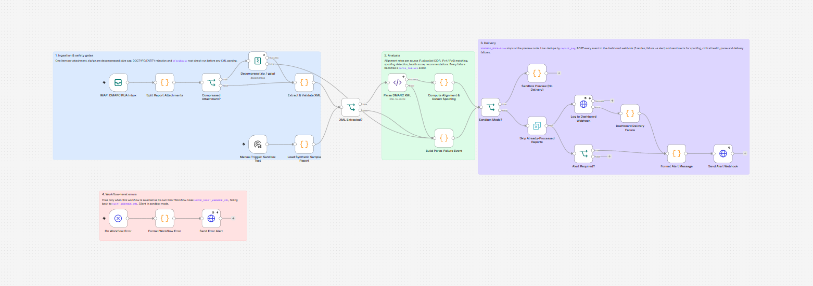
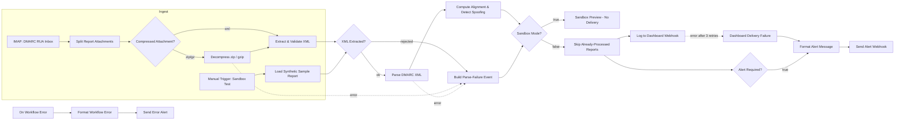

# n8n-outbound-dns-dmarc-rua-xml-report-parser

> Automated DMARC aggregate (`rua`) report pipeline for n8n: pulls the XML reports from an IMAP inbox, decompresses and safety-checks them, computes SPF/DKIM alignment pass rates per sending IP, classifies every source (authorized, unlisted, forwarder, spoofing), scores domain authentication health, and logs structured events to your dashboard, with alerts for spoofing and failures.

Full text: DISCLAIMER.md · Licensed under the MIT License. License: MIT © 2026 dhRobin Systems · Provided as-is, see the disclaimer.

---

## Table of contents

1. [Why this exists](#why-this-exists)
2. [What it does](#what-it-does)
3. [Architecture](#architecture)
4. [Repository structure](#repository-structure)
5. [Prerequisites](#prerequisites)
6. [DNS: point your rua reports at the mailbox](#dns-point-your-rua-reports-at-the-mailbox)
7. [IMAP setup](#imap-setup)
8. [Environment variables](#environment-variables)
9. [Installation & execution](#installation--execution)
10. [Classification model](#classification-model)
11. [Health score](#health-score)
12. [Output contract (dashboard events)](#output-contract-dashboard-events)
13. [Alerts](#alerts)
14. [Error handling](#error-handling)
15. [Offline validation](#offline-validation)
16. [Security & privacy](#security--privacy)
17. [Operations](#operations)
18. [Troubleshooting](#troubleshooting)
19. [Known limitations](#known-limitations)
20. [License & disclaimer](#license)

---

## Why this exists

Outbound programs (cold email, lifecycle, transactional) live and die on domain reputation. DMARC aggregate reports are the only first-party view of **who is sending as your domain** and **whether your own senders are aligned**, but they arrive as zipped XML attachments that nobody reads. This workflow turns them into one structured event per report, so you can:

- prove alignment before moving from `p=none` to `p=quarantine` / `p=reject`,
- catch a new ESP or CRM sending unaligned mail before it hurts deliverability,
- detect spoofing infrastructure abusing your domain,
- keep a time series of authentication health per domain.

## What it does

| Stage | Behaviour |
|---|---|
| Ingest | IMAP trigger picks up unseen emails, downloads attachments, marks messages read after processing. |
| Unpack | One item per attachment; `.zip` and `.gz` are decompressed, raw `.xml` passes through; other files are ignored. |
| Safety gates | Size cap (`MAX_XML_BYTES`), `DOCTYPE`/`ENTITY` rejection (XXE / entity-expansion defence), `<feedback>` root check. |
| Parse | Native n8n XML node, `explicitArray=false`; single/multiple records are normalised in code. |
| Analyse | Per source IP: DKIM-aligned, SPF-aligned and DMARC pass rates, raw SPF/DKIM auth rates, dispositions, header/envelope domains, override reasons. |
| Classify | IPv4/IPv6 CIDR allowlist matching, forwarding detection, spoofing threshold, eight source classes. |
| Score | Legitimate-traffic DMARC pass rate → `healthy` / `warning` / `critical`, plus policy recommendations. |
| Deliver | Dedupe by `report_key`, POST every event to the dashboard webhook, alert on spoofing / critical health / parse failures / delivery failures. |
| Sandbox | `SANDBOX_MODE=true` (default) stops before any outbound call and shows what would be sent. |

## Architecture





### Node reference

| # | Node | Type | Purpose |
|---|---|---|---|
| 1 | IMAP: DMARC RUA Inbox | Email Trigger (IMAP) v2 | Watches `INBOX` for `UNSEEN` mail, downloads attachments as `attachment_N`, marks read. |
| 2 | Split Report Attachments | Code | One item per zip/gz/xml attachment, binary renamed to `report`, email metadata kept. |
| 3 | Compressed Attachment? | IF | Routes zip/gz to decompression, xml straight through. |
| 4 | Decompress (zip / gzip) | Compression | Unpacks to `xml_*` binaries. Error output → parse failure. |
| 5 | Extract & Validate XML | Code | Binary → UTF-8, size cap, DOCTYPE/ENTITY rejection, `<feedback>` check. Sets `ok`. |
| 6 | Manual Trigger: Sandbox Test | Manual Trigger | Second entry point for testing without a mailbox. |
| 7 | Load Synthetic Sample Report | Code | Emits the embedded fixture plus one truncated report (exercises the failure path). |
| 8 | XML Extracted? | IF | `ok=true` → parse, otherwise → parse failure. |
| 9 | Parse DMARC XML | XML | XML → JSON. Malformed XML goes to the error output. |
| 10 | Compute Alignment & Detect Spoofing | Code | The analysis engine (rates, classification, health, recommendations, alert decision). |
| 11 | Build Parse-Failure Event | Code | Normalises all failure shapes into `parse_failure` events. |
| 12 | Sandbox Mode? | IF | Gate on `sandbox_mode` stamped onto every event. |
| 13 | Sandbox Preview (No Delivery) | Code | Terminal node in sandbox: summary plus the would-be payloads. |
| 14 | Skip Already-Processed Reports | Remove Duplicates v2 | Drops events whose `report_key` was seen in previous executions (history 10,000). |
| 15 | Log to Dashboard Webhook | HTTP Request v4.2 | POST event JSON, Header Auth, `X-Idempotency-Key`, 3 retries, error output. |
| 16 | Dashboard Delivery Failure | Code | Converts exhausted-retry failures into `delivery_failure` alerts. |
| 17 | Alert Required? | IF | `alert_required=true` → alert. |
| 18 | Format Alert Message | Code | Slack-compatible or generic JSON body. |
| 19 | Send Alert Webhook | HTTP Request v4.2 | POST alert, 3 retries; a final failure raises a workflow error. |
| 20–22 | On Workflow Error → Format → Send | Error Trigger / Code / HTTP | Workflow-level failure alerting (see [Error handling](#error-handling)). |

## Repository structure

```
n8n-outbound-dns-dmarc-rua-xml-report-parser/
├── workflow.json                     # n8n export (import this)
├── README.md                         # this file
├── DISCLAIMER.md                     # liability limitation + MIT license
├── .env.example                      # environment template (placeholders only)
├── .gitignore
├── package.json                      # dev tooling for the offline validator
├── sample-payloads/
│   └── dmarc-rua-sample.xml          # synthetic rua fixture (documentation IPs / example domains)
└── scripts/
    └── validate-workflow.js          # offline structure, hygiene and logic tests
```

## Prerequisites

- **n8n** self-hosted (Docker or npm), recent 1.x or 2.x. The export uses: Email Trigger (IMAP) v2, Code v2, IF v2, Compression v1.1, XML v1, Remove Duplicates v2, HTTP Request v4.2, Error Trigger v1. If your instance is older and a node imports as unknown, upgrade n8n (Remove Duplicates v2 is the most recent of these).
- **Environment access in nodes**: `N8N_BLOCK_ENV_ACCESS_IN_NODE=false`. All configuration is read through `$env`.
- **A dedicated mailbox** reachable over IMAPS (port 993) with password or app-password authentication.
- **A dashboard endpoint** that accepts JSON over HTTPS POST (any webhook receiver: another n8n workflow writing to a Data Table / Postgres / Google Sheets, a Supabase edge function, an internal API, etc.).
- **An alert endpoint**: Slack/Mattermost incoming webhook or your own HTTP endpoint.
- **Node.js 18+** only if you want to run the offline validator.

## DNS: point your rua reports at the mailbox

Reports are only sent if your DMARC record requests them. Example (placeholders):

```dns
_dmarc.example.com.  IN TXT  "v=DMARC1; p=none; rua=mailto:dmarc-reports@example.com; adkim=r; aspf=r; fo=1"
```

- Start with `p=none` while you collect data; this workflow tells you when alignment is good enough to tighten.
- **Cross-domain reporting:** if the mailbox is on a different domain from the one being reported (for example reports for `example.net` delivered to `dmarc-reports@example.com`), the receiving domain must authorize it, or most providers will not send:

  ```dns
  example.net._report._dmarc.example.com.  IN TXT  "v=DMARC1"
  ```

- Reports usually arrive once per day per provider (24-hour windows), as `.zip` or `.xml.gz` attachments.

## IMAP setup

1. **Use a dedicated mailbox** (e.g. `dmarc-reports@example.com`). The trigger processes every unseen message and marks it read. Do not point it at a human inbox.
2. **Authentication**
   - Google Workspace / Gmail: enable IMAP and use an **App Password** (requires 2-Step Verification). Host `imap.gmail.com`, port 993, SSL/TLS.
   - Microsoft 365: Basic Auth for IMAP is disabled tenant-wide by Microsoft, and the n8n IMAP credential uses username/password only. Use a provider that supports IMAP passwords or app passwords, or forward reports to such a mailbox.
   - Other providers: IMAPS on 993 with an app-specific password where supported.
3. **Create the credential in n8n:** *Credentials → Add → IMAP*, name it `IMAP - DMARC RUA Inbox`, fill in the values from your `.env` (`IMAP_HOST`, `IMAP_USER`, `IMAP_PASSWORD`, `IMAP_PORT`, SSL/TLS on). Leave *Allow Unauthorized Certificates* **off**.
4. **Optional, credential injection for containers:** n8n can preload credential fields from `CREDENTIALS_OVERWRITE_DATA`, so the password never has to be typed into the UI. Note that this applies to *every* IMAP credential on the instance:

   ```bash
   CREDENTIALS_OVERWRITE_DATA='{"imap":{"host":"imap.example.com","port":993,"secure":true,"user":"dmarc-reports@example.com","password":"your_imap_password_here"}}'
   ```

5. **Optional, narrower search:** the trigger uses `["UNSEEN"]`. Most reporters follow RFC 7489's `Report Domain:` subject convention, so you can narrow it to `["UNSEEN", ["SUBJECT", "Report Domain"]]` under *Options → Custom Email Rules*. Some reporters deviate, so test before relying on it.
6. **Mailbox:** defaults to `INBOX`. If you route reports into a folder with a server-side rule, change the node's *Mailbox Name*.

## Environment variables

All values in `.env.example` are placeholders.

| Variable | Default | Required | Description |
|---|---|---|---|
| `N8N_BLOCK_ENV_ACCESS_IN_NODE` | n/a | **yes** | Must be `false`; nodes read config via `$env`. |
| `N8N_ENCRYPTION_KEY` | n/a | recommended | Your own random key for n8n credential encryption. |
| `N8N_DEFAULT_BINARY_DATA_MODE` | `default` | recommended | `filesystem` keeps attachments off the heap. |
| `GENERIC_TIMEZONE` / `TZ` | `UTC` | no | Workflow timezone. All emitted timestamps are ISO-8601 UTC. |
| `IMAP_HOST` / `IMAP_PORT` / `IMAP_SECURE` / `IMAP_USER` / `IMAP_PASSWORD` | n/a | for the credential | Copied into the IMAP credential (n8n does not read them directly). |
| `SANDBOX_MODE` | `true` | no | `true` = no outbound calls. Anything except `false`/`0`/`no`/`off` counts as sandbox, and unset means sandbox. |
| `DASHBOARD_WEBHOOK_URL` | n/a | live | HTTPS endpoint receiving every event. |
| `DASHBOARD_WEBHOOK_TOKEN` | n/a | live | Reference only; put it in the **Dashboard Webhook Auth** Header Auth credential. |
| `ALERT_WEBHOOK_URL` | n/a | live | Alert destination. |
| `ERROR_ALERT_WEBHOOK_URL` | falls back to alert URL | no | Separate channel for workflow-level errors. |
| `ALERT_PAYLOAD_FORMAT` | `slack` | no | `slack` → `{text}`; `generic` → `{text, event_type, report_key, event}`. |
| `DOMAIN_WATCHLIST` | empty (all in scope) | recommended | Comma-separated domains you own; others are logged with `in_scope=false`, never alerted. |
| `AUTHORIZED_SENDER_IPS` | empty | **strongly recommended** | IPv4/IPv6 addresses or CIDRs of your legitimate senders. Invalid entries are reported in `config_warnings`. |
| `SPOOF_MIN_MESSAGES` | `5` | no | Unforwarded DMARC failures from an unlisted, never-passing IP needed to classify it as spoofing. |
| `HEALTH_WARN_THRESHOLD` | `98` | no | Health score below this → `warning`. |
| `HEALTH_CRITICAL_THRESHOLD` | `90` | no | Health score below this → `critical`. |
| `ALERT_ON_SPOOFING` | `true` | no | Alert when spoofing sources are found. |
| `ALERT_ON_WARNING` | `false` | no | Alert on `warning` health too (critical always alerts). |
| `ALERT_ON_PARSE_FAILURE` | `true` | no | Alert when a report cannot be parsed. |
| `MAX_SPOOF_SOURCES_IN_ALERT` | `10` | no | Cap on IPs listed in one alert message. |
| `MAX_XML_BYTES` | `26214400` | no | Max decompressed report size (25 MiB). |

## Installation & execution

### 1. Run n8n with the environment file

```bash
cp .env.example .env        # then edit .env with your own values
docker volume create n8n_data
docker run -d --name n8n \
  -p 5678:5678 \
  --env-file .env \
  -v n8n_data:/home/node/.n8n \
  docker.n8n.io/n8nio/n8n
```

(For an existing instance, add the variables to its environment and restart it.)

### 2. Import the workflow

*Workflows → Import from File → `workflow.json`*. It imports **inactive**.

### 3. Bind credentials

The export contains placeholder credential references only (`REPLACE_WITH_...`). Open and re-select:

- **IMAP: DMARC RUA Inbox** → your `IMAP - DMARC RUA Inbox` credential.
- **Log to Dashboard Webhook** → a *Header Auth* credential named `Dashboard Webhook Auth` (e.g. Name `Authorization`, Value `Bearer <your token>`). If your endpoint uses another scheme, change the node's authentication.

### 4. Enable workflow-level error alerts

*Workflow → Settings → Error Workflow →* select **this same workflow**, then save. Without this, the *On Workflow Error* branch never fires (per-item failures are still handled inside the main flow).

### 5. Test in sandbox

1. Ensure `SANDBOX_MODE=true`.
2. Click **Execute workflow** with *Manual Trigger: Sandbox Test* selected.
3. Open **Sandbox Preview (No Delivery)**. With the `.env.example` allowlist you should see two items:
   - `example.com | Example Mailbox Provider | 1765 msgs | DMARC pass 95.47% | health healthy (98.83%) | spoofing sources 1` → `would_send_alert: true`
   - `parse_failure: xml_parse_error (sandbox-malformed-fixture.xml)` → `would_send_alert: true`
4. Set `INCLUDE_MALFORMED_FIXTURE = false` in *Load Synthetic Sample Report* once you have seen the failure path.
5. Optional: forward a real report into the mailbox, activate the workflow while still in sandbox mode, and inspect the execution.

### 6. Go live

1. Set `SANDBOX_MODE=false` and restart n8n (env changes need a restart).
2. Run the sandbox trigger once more. The sample now goes to your real dashboard and alert channel; confirm both received it.
3. **Activate** the workflow. The IMAP trigger keeps a connection open and processes reports as they arrive (typically daily per provider).

## Classification model

Each source IP in a report is aggregated across its records, then classified in this order:

| Order | Condition | Class | Severity | In health score |
|---|---|---|---|---|
| 1 | No DMARC failures, IP on allowlist | `authorized_aligned` | ok | yes |
| 1 | No DMARC failures, no allowlist configured | `aligned_sender` | ok | yes |
| 1 | No DMARC failures, IP **not** on allowlist | `unlisted_aligned_sender` | info | yes |
| 2 | Failures, IP on allowlist | `authorized_misaligned` | warning | yes |
| 3 | All failures carry a `forwarded` / `mailing_list` / `trusted_forwarder` override | `probable_forwarder` | info | no |
| 4 | Some messages pass, some fail, IP not on allowlist | `unlisted_partially_aligned` | warning | yes |
| 5 | Never passes, unforwarded failures ≥ `SPOOF_MIN_MESSAGES` | `unauthorized_spoofing` | critical | no |
| 6 | Never passes, below threshold | `unauthorized_low_volume` | warning | no |

Definitions:

- **DKIM aligned / SPF aligned** = the reporter's `policy_evaluated.dkim` / `.spf` verdict (`pass` means authenticated *and* aligned with the `From:` domain under your `adkim`/`aspf` mode).
- **DMARC pass** = DKIM aligned **or** SPF aligned.
- **DKIM auth / SPF auth** = any raw `auth_results` pass, regardless of alignment. A high auth rate with a low aligned rate points to a vendor signing or bouncing with *its* domain instead of yours. In the fixture, `192.0.2.25` shows this for SPF (100% auth, 0% aligned).
- An IP that passes DMARC is **never** classed as spoofing: passing requires your DKIM key or your SPF authorization.

## Health score

```
health_score = DMARC-passing messages / messages   (only classes marked "in health score")
```

Spoofing, low-volume unauthorized and forwarded traffic is excluded: DMARC *failing* that mail is the system working, not a defect in your own sending. The score therefore answers *"is my legitimate mail authenticating?"*. Spoofing is reported separately in `spoofing.*`.

| Status | Rule |
|---|---|
| `healthy` | score ≥ `HEALTH_WARN_THRESHOLD` |
| `warning` | `HEALTH_CRITICAL_THRESHOLD` ≤ score < warn |
| `critical` | score < `HEALTH_CRITICAL_THRESHOLD` |
| `no_legitimate_traffic` | nothing left after exclusions |

Recommendations are generated for `p=none`, `pct<100`, a missing allowlist, misaligned authorized senders, unlisted aligned senders, and spoofing under `p=none`.

## Output contract (dashboard events)

Every event is POSTed as JSON with header `X-Idempotency-Key: <report_key>`. **Upsert on `report_key`**: reporters occasionally resend reports. Three event types share `event_type`, `schema_version`, `report_key`, `processed_at`, `alert_required`, `alert_reasons` and a flat `dashboard_row` (ready for a table/sheet insert).

### `dmarc_report` (abridged, from the sample)

```json
{
  "event_type": "dmarc_report",
  "schema_version": "1.0",
  "report_key": "Example Mailbox Provider|synthetic-rua-20261116-0001",
  "in_scope": true,
  "sandbox_mode": false,
  "processed_at": "2026-11-18T10:00:00.000Z",
  "source": "imap",
  "file_name": "example.org!example.com!1794787200!1794873599.zip",
  "reporter": { "org_name": "Example Mailbox Provider", "email": "noreply-dmarc-support@example.org", "report_id": "synthetic-rua-20261116-0001" },
  "date_range": { "begin": "2026-11-16T00:00:00.000Z", "end": "2026-11-16T23:59:59.000Z" },
  "policy_domain": "example.com",
  "policy": { "p": "none", "sp": "none", "np": null, "pct": 100, "adkim": "r", "aspf": "r", "fo": "1" },
  "totals": { "messages": 1765, "unique_ips": 8, "dkim_aligned_pass": 1685, "spf_aligned_pass": 1285, "dmarc_pass": 1685, "dmarc_fail": 80, "dispositions": { "none": 1765 } },
  "rates": { "dkim_aligned": 95.47, "spf_aligned": 72.8, "dmarc_pass": 95.47, "dkim_auth": 95.47, "spf_auth": 96.15 },
  "health": { "score": 98.83, "status": "healthy", "legitimate_messages": 1705, "legitimate_dmarc_pass": 1685, "warn_threshold": 98, "critical_threshold": 90 },
  "spoofing": { "source_count": 1, "message_count": 45, "sources": [ { "source_ip": "198.51.100.77", "messages": 45, "header_from": ["example.com"], "envelope_from": ["spoof-relay.example.net"] } ] },
  "classification_counts": { "authorized_aligned": 3, "unlisted_aligned_sender": 1, "authorized_misaligned": 1, "unauthorized_spoofing": 1, "probable_forwarder": 1, "unauthorized_low_volume": 1 },
  "per_ip": [ { "source_ip": "192.0.2.10", "authorized": true, "classification": "authorized_aligned", "severity": "ok", "messages": 1200, "dkim_aligned_rate": 100, "spf_aligned_rate": 100, "dmarc_pass_rate": 100, "...": "..." } ],
  "recommendations": [ "Policy is p=none (monitor only): ..." ],
  "config_warnings": [],
  "malformed_records": 0,
  "alert_required": true,
  "alert_reasons": [ "1 unauthorized spoofing source(s), 45 message(s)" ],
  "dashboard_row": { "report_key": "...", "policy_domain": "example.com", "messages": 1765, "dmarc_pass_rate": 95.47, "health_score": 98.83, "health_status": "healthy", "spoofing_sources": 1, "...": "..." }
}
```

### `parse_failure`

Fields: `reason` (`xml_parse_error`, `decompression_failed`, `xml_too_large`, `doctype_or_entity_rejected`, `not_a_dmarc_aggregate_report`, `binary_read_error`, `no_binary_after_decompression`, `missing_required_dmarc_sections`), `error_message`, `file_name`, `email_subject`, `email_from`, `message_id`.

### `delivery_failure`

Emitted only to the alert channel, when the dashboard POST fails after 3 retries: `target`, `failed_report_key`, `error_message`.

### Suggested dashboard tables

- `dmarc_reports`, one row per `dashboard_row`, primary key `report_key`.
- `dmarc_report_sources`, one row per `per_ip[]` element, key `(report_key, source_ip)`.
- Widgets: DMARC pass / DKIM aligned / SPF aligned rate per domain over time; health status timeline; spoofing IPs and volume; top unlisted aligned senders (allowlist candidates).

## Alerts

Alerts fire when any of these hold for an **in-scope** report: spoofing found (`ALERT_ON_SPOOFING`), health `critical`, health `warning` with `ALERT_ON_WARNING=true`. Parse failures (`ALERT_ON_PARSE_FAILURE`) and dashboard delivery failures also alert. Example `slack` text from the sample:

```
[DMARC] HEALTHY | example.com | report synthetic-rua-20261116-0001 from Example Mailbox Provider
Window: 2026-11-16T00:00:00.000Z to 2026-11-16T23:59:59.000Z
Messages: 1,765 | DMARC pass: 95.47% | DKIM aligned: 95.47% | SPF aligned: 72.8%
Legitimate-traffic health score: 98.83% (warning below 98%, critical below 90%)
Unauthorized spoofing sources: 1 IP(s), 45 message(s)
  - 198.51.100.77: 45 msgs, header_from example.com, disposition none=45
Published policy: p=none sp=none pct=100 adkim=r aspf=r
Triggered by: 1 unauthorized spoofing source(s), 45 message(s)
Next steps:
  - Policy is p=none (monitor only): spoofed mail is still delivered. ...
```

## Error handling

| Failure | Handling |
|---|---|
| Email has no report attachment | Dropped at *Split Report Attachments* (nothing to do). |
| Corrupt zip / gzip | Compression node error output → `parse_failure` (`decompression_failed`). |
| Oversize, DOCTYPE/ENTITY, non-DMARC XML | `ok=false` → `parse_failure` with the specific reason. |
| Malformed XML | XML node error output → `parse_failure` (`xml_parse_error`). |
| Valid XML missing DMARC sections | Detected in compute → `parse_failure` (`missing_required_dmarc_sections`). |
| Bad allowlist entries / inverted thresholds | Run continues; listed in `config_warnings`. |
| Dashboard endpoint down | 3 retries (3 s apart) → `delivery_failure` alert. |
| Alert endpoint down | 3 retries → node error → workflow error → *On Workflow Error* → `ERROR_ALERT_WEBHOOK_URL` (falls back to the alert URL). That last call continues on failure, so it cannot loop. |
| Duplicate report | Skipped by *Skip Already-Processed Reports*; also idempotent at the dashboard via `X-Idempotency-Key`. |
| IMAP connection drops | The trigger reconnects every 60 minutes (`forceReconnect`) and on n8n restart; unseen mail is picked up then. |

Executions are saved on error (`saveDataErrorExecution: all`) and not on success (`saveDataSuccessExecution: none`), which keeps report IPs out of the execution log. Change this in *Settings* if you need successful-run history.

## Offline validation

`scripts/validate-workflow.js` tests the repository without an n8n instance. It extracts the **actual Code-node source from `workflow.json`**, runs it in a VM against the fixture (parsed with `xml2js` using the XML node's exact options) and asserts structure, licensing, secret hygiene, fixture IP ranges, attachment classification, safety gates, every source classification, rates, health score, alert decisions and sandbox suppression.

```bash
npm install
npm test
```

Run it in CI on every change to `workflow.json`. If you edit the fixture, also update the embedded copy in *Load Synthetic Sample Report*; the validator fails when the two drift apart.

## Security & privacy

- **No secrets in the repo.** Credentials are bound in n8n's encrypted credential store; the export carries placeholder IDs only. `.env` is git-ignored.
- **XML hardening.** `DOCTYPE`/`ENTITY` declarations are rejected before parsing, and decompressed size is capped, which defends against XXE, billion-laughs and zip-bomb payloads in attacker-controlled mail. Anyone can email a DMARC-looking attachment to a public `rua` address, so treat every report as untrusted input.
- **Spoofed reports.** The workflow does not verify that a report really came from the claimed provider. A forged report can inject noise into the dashboard; it cannot trigger changes, because the workflow never writes DNS.
- **Personal data.** Reports contain IP addresses and domains, which may be personal data under GDPR/CCPA. Define retention for the dashboard and the mailbox.
- **Least privilege.** Use a dedicated mailbox and an app password scoped to IMAP, plus a dashboard token that can only write the DMARC tables.
- **Env access.** `N8N_BLOCK_ENV_ACCESS_IN_NODE=false` exposes all env vars to every workflow on the instance. Keep secrets in credentials (not env) and restrict who can edit workflows.

## Operations

- **Volume:** a typical report is 1–50 KB. Large senders can receive multi-MB reports from big providers; keep `N8N_DEFAULT_BINARY_DATA_MODE=filesystem` and raise `MAX_XML_BYTES` only if needed.
- **Allowlist hygiene:** review `unlisted_aligned_sender` IPs weekly. They are usually a new SaaS tool sending on your behalf.
- **Policy progression:** stay on `p=none` until health is `healthy` for 2–4 weeks across all major reporters, then `p=quarantine; pct=25` → `pct=100` → `p=reject`.
- **Backfill:** mark old report emails as unread in the mailbox; the trigger will process them (dedupe prevents double logging).
- **Reset dedupe history:** run the Remove Duplicates node's *Clear Deduplication History* operation manually, or change its scope.

## Troubleshooting

| Symptom | Fix |
|---|---|
| `access to env vars denied` / everything behaves as sandbox | Set `N8N_BLOCK_ENV_ACCESS_IN_NODE=false` and restart n8n. |
| Nothing triggers | Confirm IMAP credentials (*Test* in the credential), the mailbox name, that the messages are **unseen**, and that the workflow is **active**. |
| Every report is `not_a_dmarc_aggregate_report` | You may be receiving forensic (`ruf`) reports or bounces. Check the `rua` vs `ruf` addresses. |
| `decompression_failed` on `.gz` | Some providers send gzip with an unusual MIME type; the splitter forces `fileExtension` from the filename. Check the attachment name ends in `.gz`. |
| Legitimate ESP flagged `unauthorized_spoofing` | Its IPs are not in `AUTHORIZED_SENDER_IPS` **and** it is not DKIM-signing with your domain. Fix alignment (custom DKIM domain) and add its ranges. |
| Remove Duplicates node shows as unknown | Your n8n version predates Remove Duplicates v2. Upgrade, or delete the node and rely on dashboard upserts via `X-Idempotency-Key`. |
| Slack returns `invalid_payload` | Use `ALERT_PAYLOAD_FORMAT=slack` (the `generic` format adds non-Slack fields). |

## Known limitations

- **Real-time, not batched.** The IMAP trigger processes each report as it arrives. Providers send daily, so you get daily data per provider, but there is no built-in cross-report daily rollup; aggregate by `date_range` in the dashboard.
- **Reporter verdicts are trusted.** Alignment comes from `policy_evaluated`; the workflow does not re-evaluate DKIM signatures or apply the Public Suffix List itself.
- **Per-report thresholds.** `SPOOF_MIN_MESSAGES` applies per report, so a slow spoofer spread across many reporters can stay under it. Watch `unauthorized_low_volume` in the dashboard.
- **No reverse DNS / ASN / geo enrichment.** Add an enrichment step after *Compute Alignment & Detect Spoofing* if you need vendor attribution.
- **IMAP auth** is username/password only (n8n IMAP credential). OAuth2-only mailboxes need a forwarding mailbox.
- **Not tested against a live n8n instance in this repo's CI.** The validator covers the code logic and export structure; always run the sandbox test after importing.

---

<a id="license"></a>

## ⚠️ Disclaimer & Liability Limitation

**Use at your own risk.** The code, workflows, and scripts provided in this repository (`n8n-outbound-dns-dmarc-rua-xml-report-parser`) are for educational and architectural demonstration purposes.

**No Liability:** The author and dhRobin Systems assume no responsibility or liability for any direct, indirect, incidental, or consequential damages resulting from the use, misuse, or deployment of these scripts and workflows.

**Email Authentication, DNS & Alerting Risks:** DMARC monitoring carries inherent risks. Misconfigured allowlists, thresholds or reporter XML can misclassify legitimate senders as spoofing (or miss real spoofing), produce misleading health scores, or flood alert channels. Tightening DMARC policy or changing SPF/DKIM records based on this output can cause legitimate email to be rejected or lost. This workflow reads your IMAP mailbox (marking messages read) and writes to the dashboard and alert webhooks you configure; it never modifies DNS.

**User Responsibility:** You are solely responsible for compliance with applicable laws, regulations, and contracts, including data-protection and privacy rules (such as GDPR, CCPA, and CASL), and the terms of service of your mailbox provider, n8n, your alerting and dashboard platforms, and any other provider you connect. You are also solely responsible for proper testing (`SANDBOX_MODE=true`) before connecting any scripts to production environments, live mailboxes, or live notification channels.

Full text: [DISCLAIMER.md](DISCLAIMER.md) · Licensed under the MIT License.

## License

MIT © 2026 dhRobin Systems · Provided as-is, see the disclaimer.
